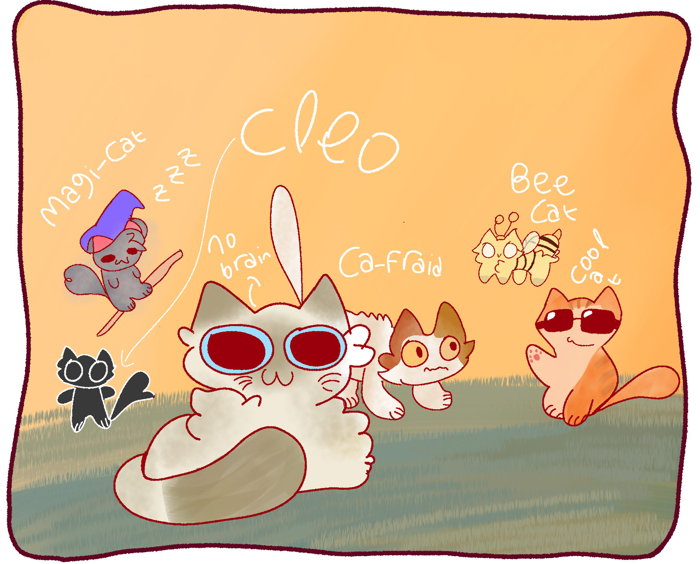
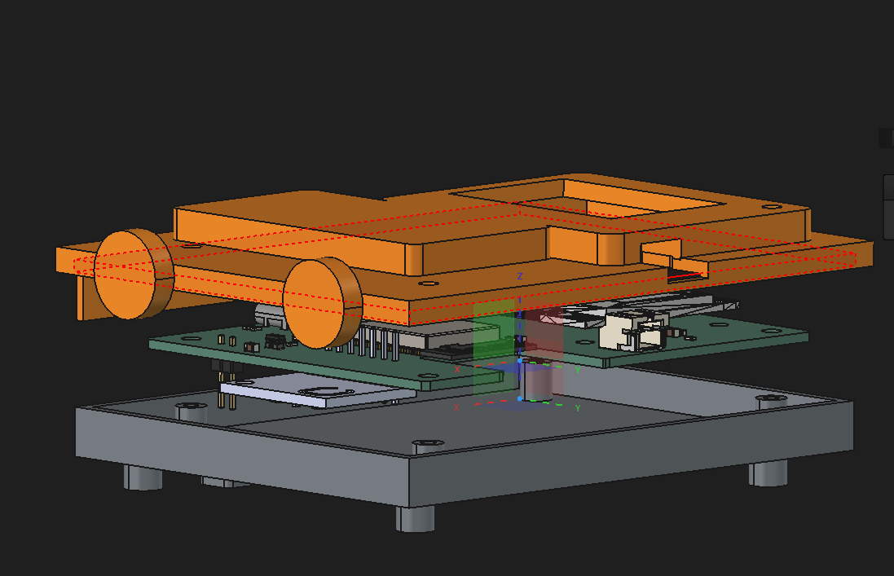
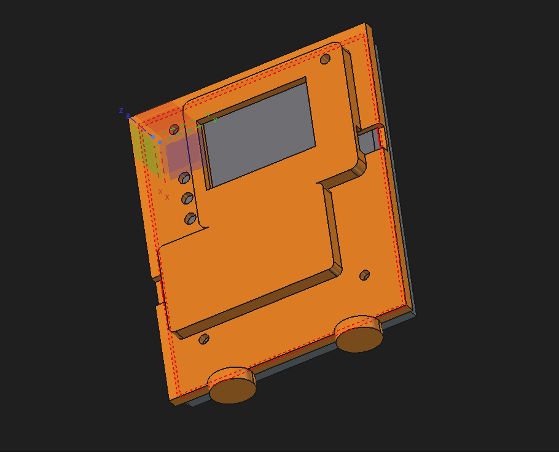
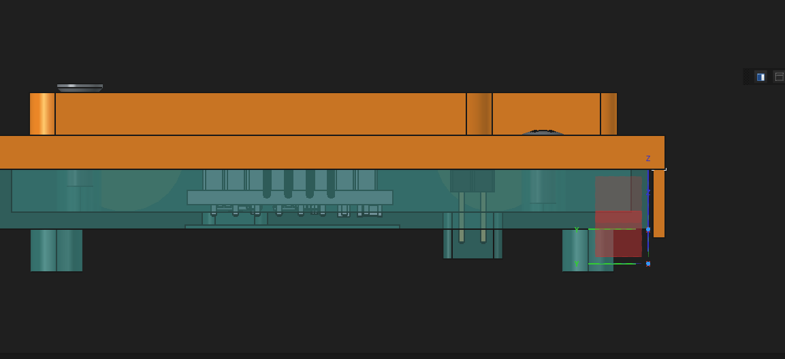
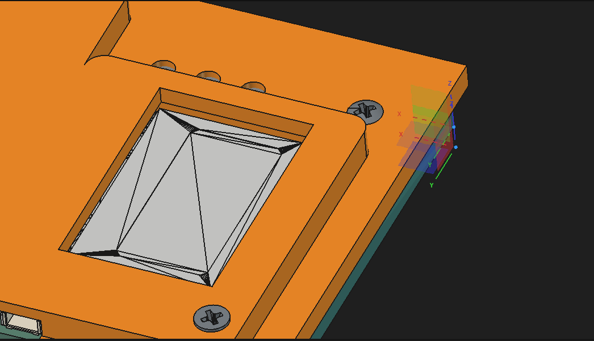
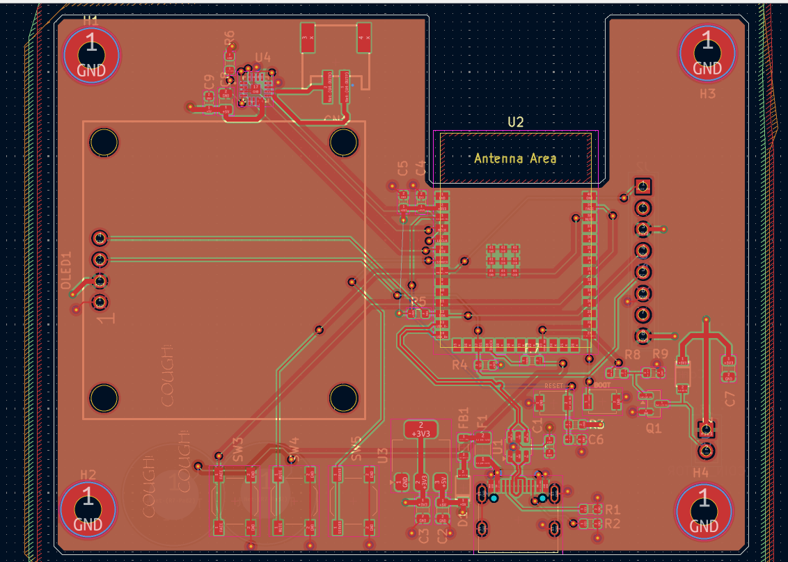
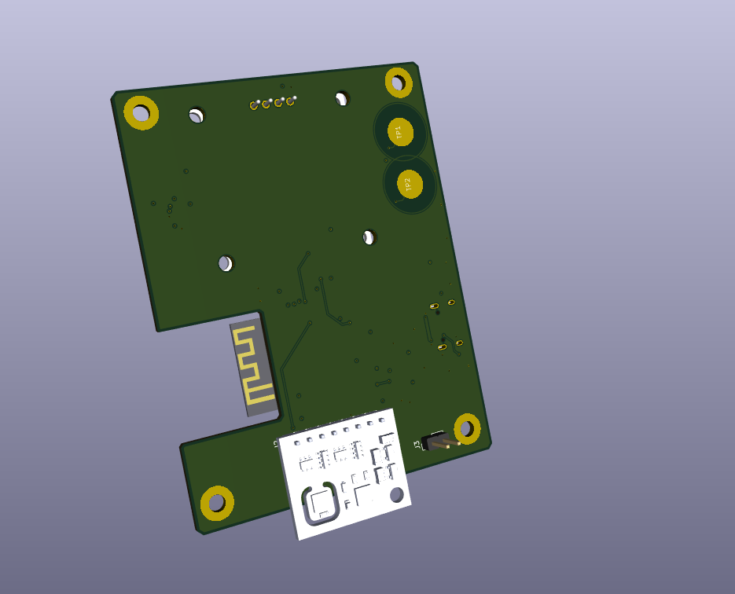
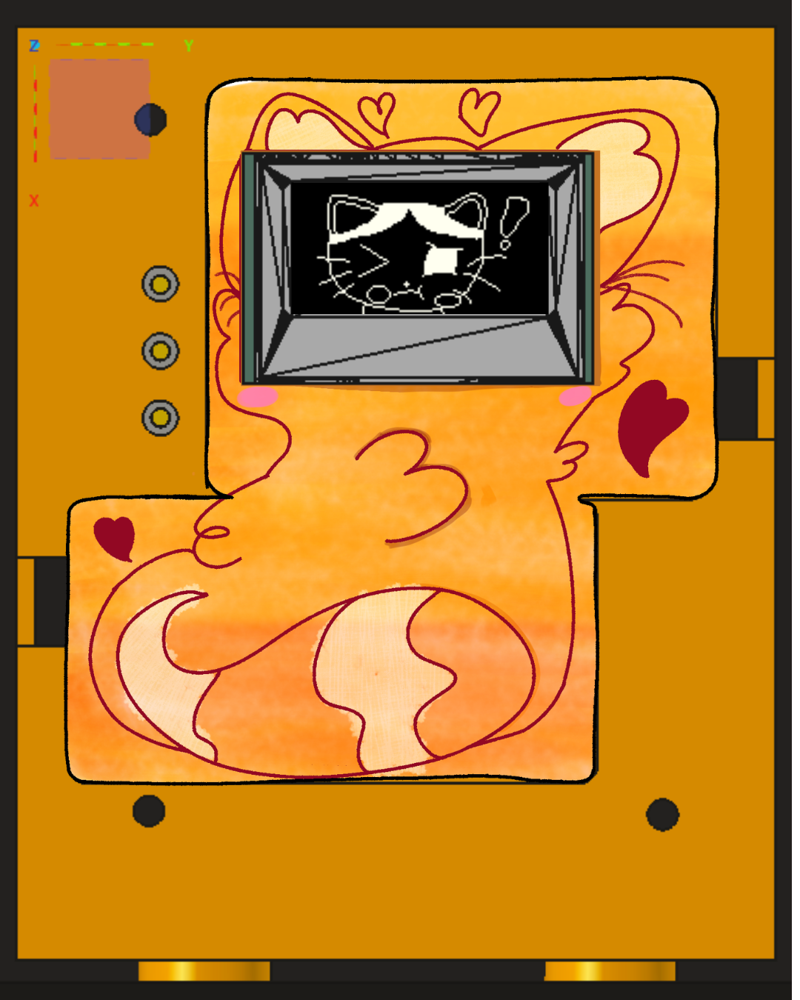

# **COUGHING CLEO**

Poor air quality monitor

*If air == bad -> cough!*

---

# SECTIONS

- [What is Coughing Cleo](#what-is-coughing-cleo)
    - [What are Cleo's expression?](#what-are-cleos-expression)
- [Why Cleo?](#why-cleo)
- [How to use it?](#how-to-use-it)
- [Footages](#footages)
    - [Enclosure and Assembly](#enclosure-and-assembly)
    - [PCB](#pcb)
    - [Schematics](#schematics)
    - [Stickers](#stickers)
- [What softwares do I need?](#what-softwares-do-i-need)

---

## What is Coughing Cleo?

<video src="footages/face.mp4" width="600" controls></video>

Coughing Cleo is an ESP32 based digital pet that detects the air quality using ENS160 sensor that will play a coughing noise if the sensor reads poor air quality.

Not only that, Cleo (the name of the cat, inside trapped inside the OLED) also show various of other expressions such as a bigger cough, sweating if the temperature is hot enough, and annoyed if the owner doesn't pet it.

### What are Cleo's expression?

Right now we have :

1. Small Cough
2. Big Cough
3. Sweating
4. Annoyed
5. Jolly when pet
6. IDLE

 
 
 
 

 

Also you can see Cleo and its companion at the back part of the bottom enclosure artwork!

 

Cleo is the black and white cat on the left side!

---

## Why Cleo?

Many pollutants have no smell or colors! That is why sometimes we didn't realize these pollutants were hurting us in different ways; they made us feel dizzy, headache, tired, and other long-term risks.

By having Coughing Cleo inside your room or any other place, you'd be able to hear its cough and then take an action regarding the poor air quality! Whether you move to another place, open a window, or take any other action, Cleo will be the one to remind you to do it!

My inspiration for this project was the Karhutla event in Indonesia, or Forest Fires. Although the sensor itself doesn't detect the particles from forest fires' smoke or solve the pollution issue directly, Coughing Cleo is made to raise the awareness of how important air quality is to a human being!

---

## How to use it?

After you assembled the whole thing and flashed the firmware into the PCB as well as applied those cute stickers, here's how to use it.

1. Plug it into a power source using USB type C.
2. Whether you make it stand horizontally or vertically, make sure the backpart, specifically the sensor area, is exposed to the open space.

Now Cleo the Cat will tell you if there's something wrong with your air!

Additionally, you can access the web interface to change the coughing sound or export the data logs.

---

## Footages
Take a look at Coughing Cleo!

### Enclosure and Assembly

 
 

You'll need
1. 3 pcs of M3x8 screws
2. A piece of M3x12 screw

 
 

### PCB
 

 

### Schematics
Read the PDF file for a better look!
 

### Stickers
 
 
 

---

## What softwares do I need?

There are various of tools were used to design Coughing Cleo. Here are the tools that you might need to install to open the project files!

1. PCB ➜  Use **KiCad** to open/edit schematics and PCB
2. Enclosure ➜ Use **FreeCAD** to open/edit the enclosure model
3. Face Sprite ➜  Use **Aseprite** or **Resprite** to open the .aseprite file to access Cleo The Cat faces
    - As for the face module test you can paste the project codes or import it to Wokwi or **[Here](https://wokwi.com/projects/479777241218679809)**
4. Sticker Artwork ➜ inside `ibis_files` folder you can found .ipv files, use **Ibis Paint X app** to access the art work files
5. Sticker Print ➜ Feel free to print the PDF or you can change the layout using **Inkscape**
6. Web Interface UI design ➜ Use **Penpot** to open the web interface design

---

## BOM
(tba)
