

# **COUGHING CLEO**

Poor air quality monitor.

*If air == bad -> cough!*

 

---

# SECTIONS

- [What is Coughing Cleo](#what-is-coughing-cleo)
    - [What are Cleo's expression?](#what-are-cleos-expression)
- [Why Cleo?](#why-cleo)
- [How to use it?](#how-to-use-it)
- [What Does This Repository Include?](#what-does-this-repository-include)
- [Footages](#footages)
    - [PCB and Schematics](#pcb-and-schematics)
        - [Custom ESP32-S3 Chip Based](#custom-esp32-s3-chip-based)
        - [XIAO ESP32-S3 Based](#xiao-esp32-s3-based)
    - [Enclosure and Assembly](#enclosure-and-assembly)
    - [Schematics](#schematics)
    - [Stickers](#stickers)
    - [Web Interface](#web-interface)
- [What softwares do I need?](#what-softwares-do-i-need)
- [BOM](#bom)
    - [Main BOM](#main-bom)
    - [Other BOMs](#other-boms)
---

## What is Coughing Cleo?

    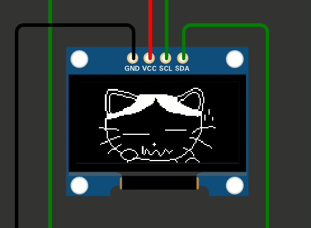</img>

Coughing Cleo is an ESP32 based digital pet that detects the air quality using ENS160 sensor that will play a coughing noise if the sensor reads poor air quality.

Not only that, Cleo (the name of the cat, inside trapped inside the OLED) also show various of other expressions such as a bigger cough, sweating if the temperature is hot enough, and annoyed if the owner doesn't pet it.

### What are Cleo's expression?

Right now we have :

1. Small Cough
2. Big Cough
3. Sweating
4. Annoyed
5. Jolly when pet
6. IDLE

  
  
  
  
  
  

Also you can see Cleo and its companion at the back part of the bottom enclosure artwork!

 

Cleo is the black and white cat on the left side!

---

## Why Cleo?

Many pollutants have no smell or colors! That is why sometimes we didn't realize these pollutants were hurting us in different ways; they made us feel dizzy, headache, tired, and other long-term risks.

By having Coughing Cleo inside your room or any other place, you'd be able to hear its cough and then take an action regarding the poor air quality! Whether you move to another place, open a window, or take any other action, Cleo will be the one to remind you to do it!

My inspiration for this project was the Karhutla event in Indonesia, or Forest Fires. Although the sensor itself doesn't detect the particles from forest fires' smoke or solve the pollution issue directly, Coughing Cleo is made to raise the awareness of how important air quality is to a human being!

---

## Cleo's Coughing Condition

Based on the sensor readings, this is the table for Cleo's cough.

### **TVOC LEVEL**

| TVOC (PPB)  | Indication   | Cough             |
|-------------|--------------|-------------------|
| < 150       | Safe         | No Cough          |
| 150 - 500   | Acceptable   | Single Cough      |
| 500 - 1500  | Conspicuous  | Small Cough       |
| 1500 - 5000 | Concerning   | Big Cough         |
| > 5000      | Unacceptable | Big Cough, louder |

### **eCO₂**

| eCO₂        | Cough             |
|-------------|-------------------|
| 400 - 600   | No Cough          |
| 600 - 800   | No Cough          |
| 800 - 1000  | Small Cough       |
| 1000 - 1500 | Big Cough         |
| > 1500      | Big Cough, louder |

### **AQI-UBA**

| AQI-UBA | Cough             |
|---------|-------------------|
| 1       | No Cough          |
| 2       | No Cough          |
| 3       | Small Cough       |
| 4       | Big Cough         |
| 5       | Big Cough, louder |

---

## How to use it?

After you assembled the whole thing and flashed the firmware into the PCB as well as applied those cute stickers, here's how to use it.

1. Plug it into a power source using USB type C.
2. Whether you make it stand horizontally or vertically, make sure the backpart, specifically the sensor area, is exposed to the open space.
3. Plug in a speaker to the JST connection

Now Cleo the Cat will tell you if there's something wrong with your air!

Additionally, you can access the web interface to change the coughing sound or export the data logs.

---

## What Does This Repository Include?

In this repository you'll get :

1. The **PCB File** inside `PCB` folder which includes both PCB and Schematics
2. The **Enclosure File** inside `Enclosure` folder
3. The **Default Audio** Files inside `Default-Audio` folder
4. The **Artwork Files** inside `Stickers` folder which includes both the editable layout file  in form of Inkscape `.svg` and the art itself
5. The **Sprite Files** inside `Face-Sprite` folder
    - There's also face sprite code module test using Wokwi simulation that utilizes different sensor because of its limited feature located inside `Face-Sprite/wokwi-test`
6. The **Web Interface Files** inside  `Web-Interface` which has :
    - The UI design files
    - The Vite-Based + Solid.Js web user interface located inside `Web-Interface/esp32-web-interface`

---

## Footages
Take a look at Coughing Cleo!

### PCB and Schematics

There are two PCB and Schematics provided inside this repository

1. The Custom PCB : A customized PCB with bare ESP32 (ESP32-S3-WROOM-1U-N8R8) chip soldered directly
2. XIAO Based PCB Board : Custom PCB board that utilizes mini XIAO ESP32-S3 DIP solder.

| **Custom ESP32 WROOM chip based**                            | **Seeed Studio XIAO ESP32-S3 based**              |
|----------------------------------------------------------|-----------------------------------------------|
| Included on JLCPCB Standard PCBA Service                 | Solder it yourself                            |
| More expensive because it utilizes Standard PCBA service | Cheaper because it uses Economic PCBA service |
| 4 Layers with power pour                                 | 4 Layers without power pour                   |
| Gerber [Click here](PCB\Custom-PCB\production\PCB.zip)   | Gerber [Click here](PCB\XIAO-Based\production\PCB.zip)                |

Now here are the screenshots:

#### Custom ESP32-S3 Chip Based

The Schematic

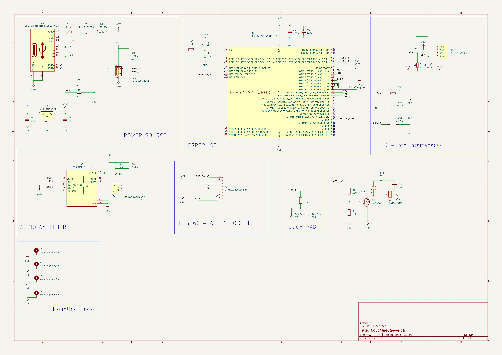 

The PCB

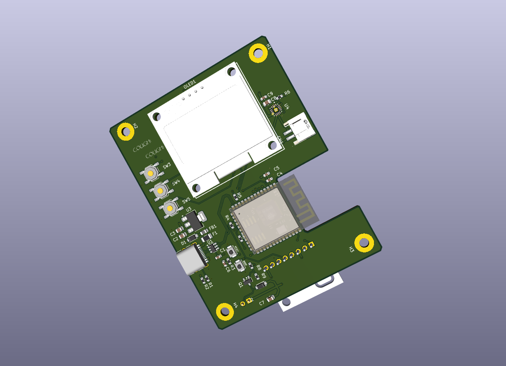

#### XIAO ESP32-S3 Based

The Schematic

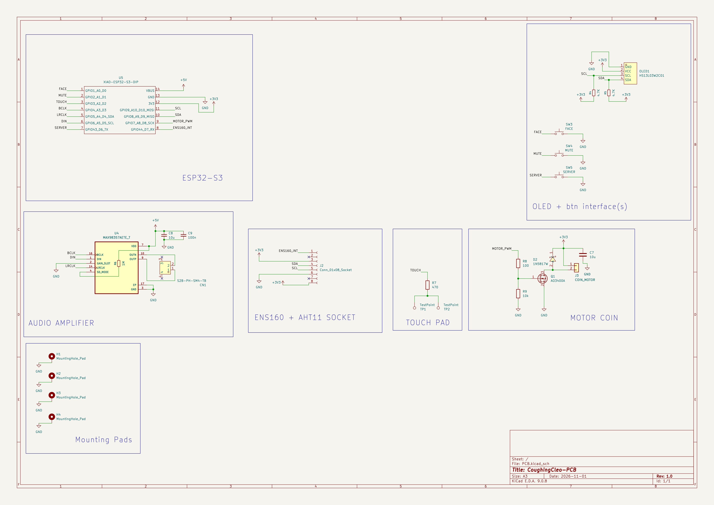 

The PCB

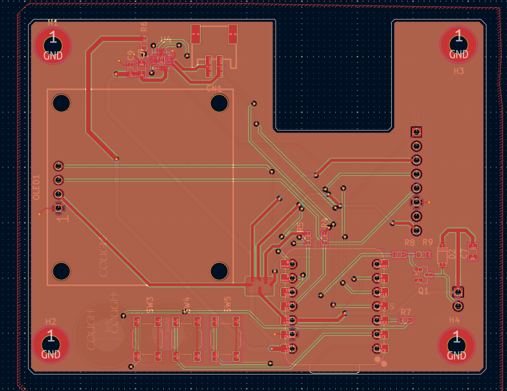 
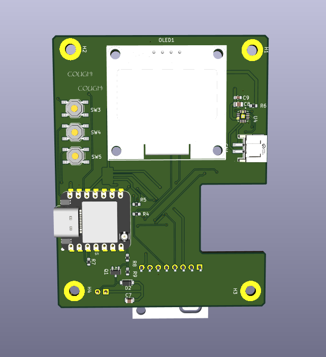 
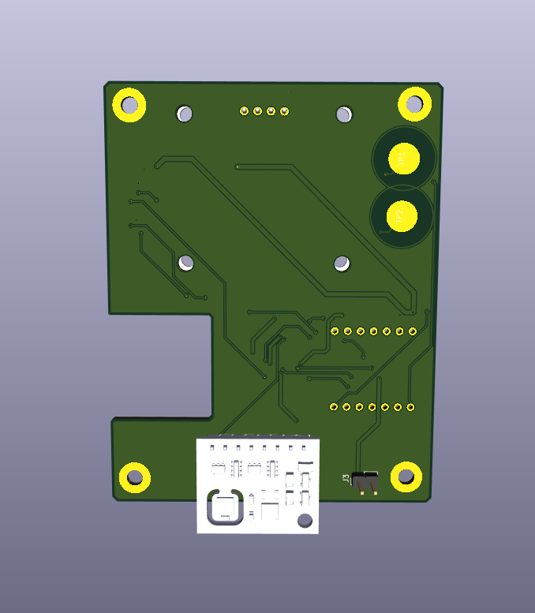 

---

### Enclosure and Assembly

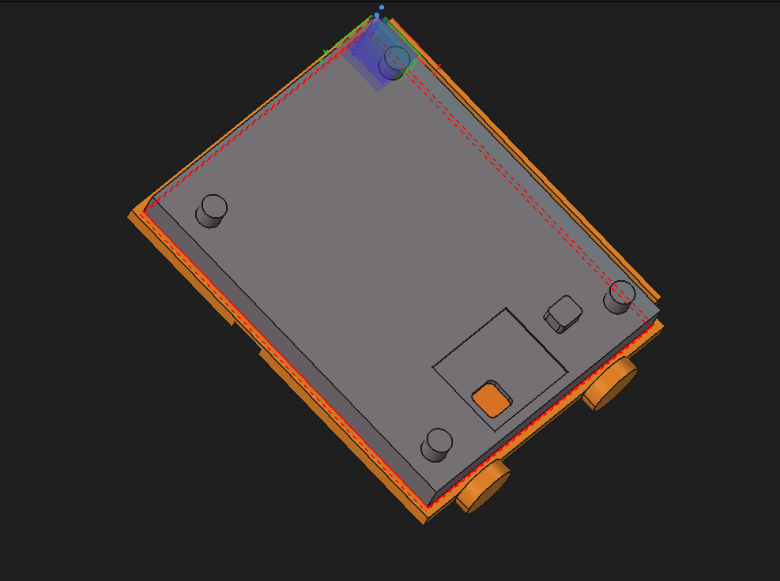 
 

For the assembly itself you'll need

1. 3 pcs of M3x8 screws
2. A piece of M3x12 screw

Why the screw differences? As you can see on the image below, one hole has a higher level than the other. To make sure the screw to be able to bite the bottom part of the enclosure, we need a taller one!

After that you can put on the stickers and plug the speaker in using the JST connection.

 
 

### Stickers
 
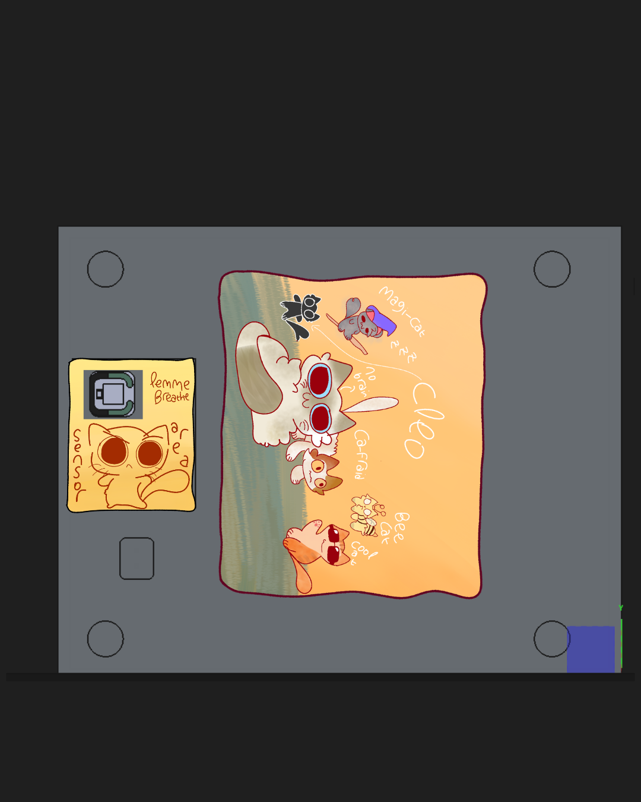 
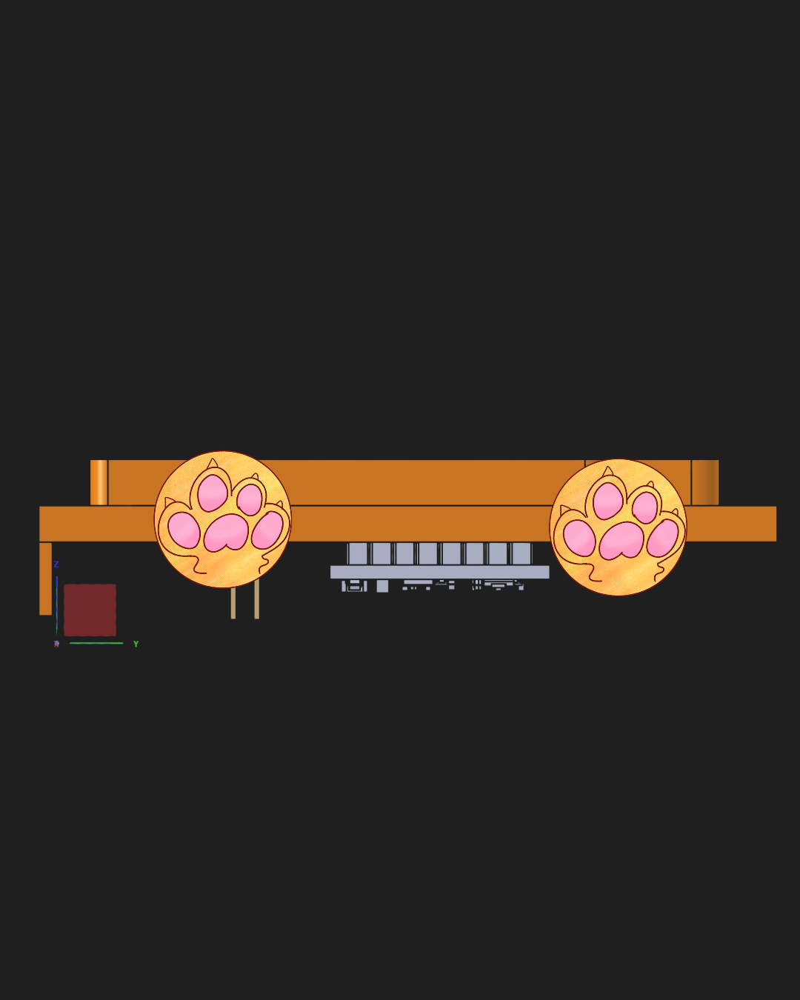 

### Web Interface
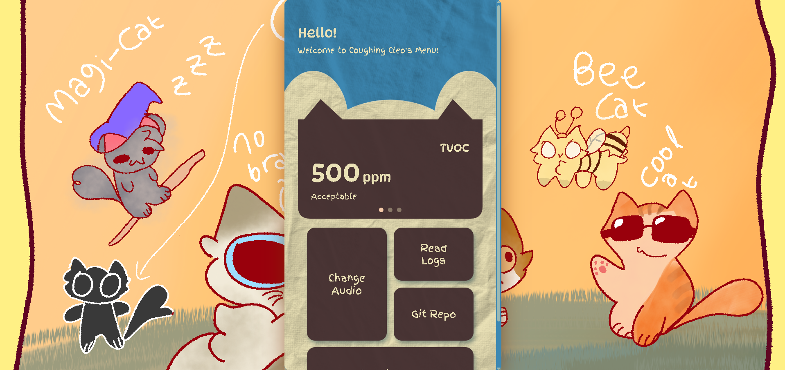 

---

## What softwares do I need?

There are various of tools were used to design Coughing Cleo. Here are the tools that you might need to install to open the project files!

1. PCB ➜  Use [**KiCad**](https://www.kicad.org/download/) to open/edit schematics and PCB
2. Audio Files ➜ Use [**Audacity 4**](https://www.musehub.com/en-us/app/audacity) in order to open the audio file projects
3. Enclosure ➜ Use [**FreeCAD**](https://www.freecad.org/downloads.php?lang=en) to open/edit the enclosure model.
4. Face Sprite ➜  Use [**Aseprite**](https://aseprite.org/) or [**Resprite**](https://resprite.fengeon.com/) to open the .aseprite file to access Cleo The Cat faces
    - As for the face module test you can paste the project codes or import it to Wokwi or **[Here](https://wokwi.com/projects/479777241218679809)**
5. Sticker Artwork ➜ inside `ibis_files` folder you can found .ipv files, use [**Ibis Paint X**](https://ibispaint.com/?lang=en-US) to access the art work files
6. Sticker Print ➜ Feel free to print the PDF or you can change the layout using [**Inkscape**](https://inkscape.org/release/inkscape-1.4.2/windows/64-bit/msi/dl/)
7. Web Interface UI design ➜ Use [**Penpot**](https://penpot.app/) to open the web interface design
8. Web Interface Development ➜ In order to run the web interface locally for testing and development, you may use [Node.Js](https://nodejs.org/en)
    - After that change your directory into `cd Web-Interface/esp32-web-interface` and go ahead run `npm install` and to run it `npm run dev`
---

## BOM

### Main BOM

Even though there's the PCB BOMs, the actual full item BOM is located at
[`BOM/main.csv`](BOM/main.csv).
You can also read the [PDF version](BOM/main.pdf) or access the [XLSX version](BOM/main.xlsx)

### Other BOMs

1. JLCPCB and KiCad Fabrication tool generated
    - `BOM\Custom-PCB\bom-JLCPCB Assembly Order.xls`
    - `BOM\XIAO-Based\bom-JLCPCB Assembly Order.xls`

---

## Development Status 

The project is still in progress!